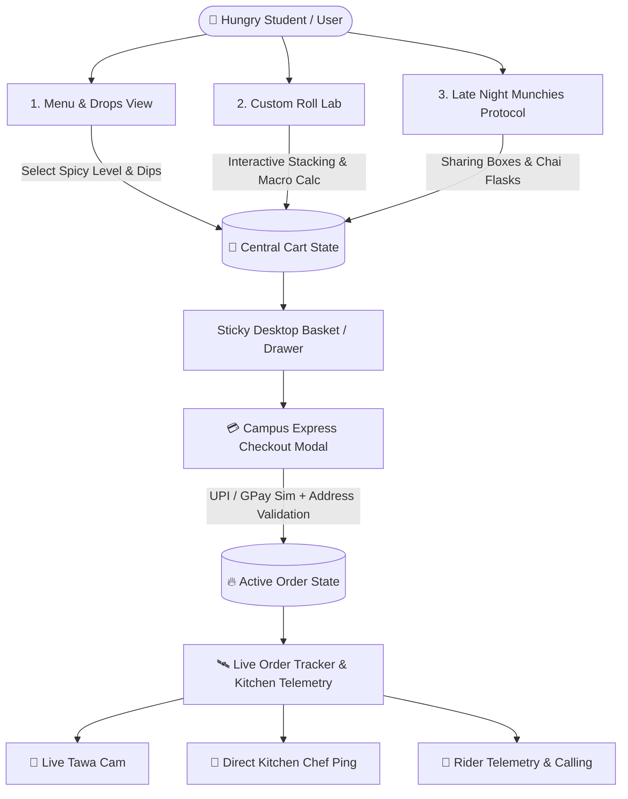
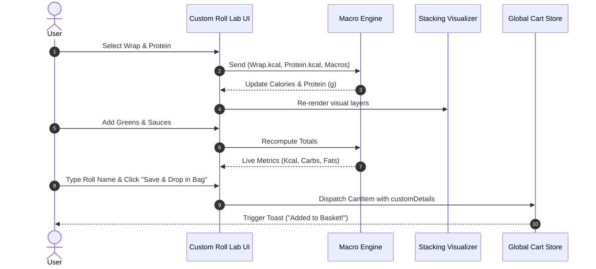
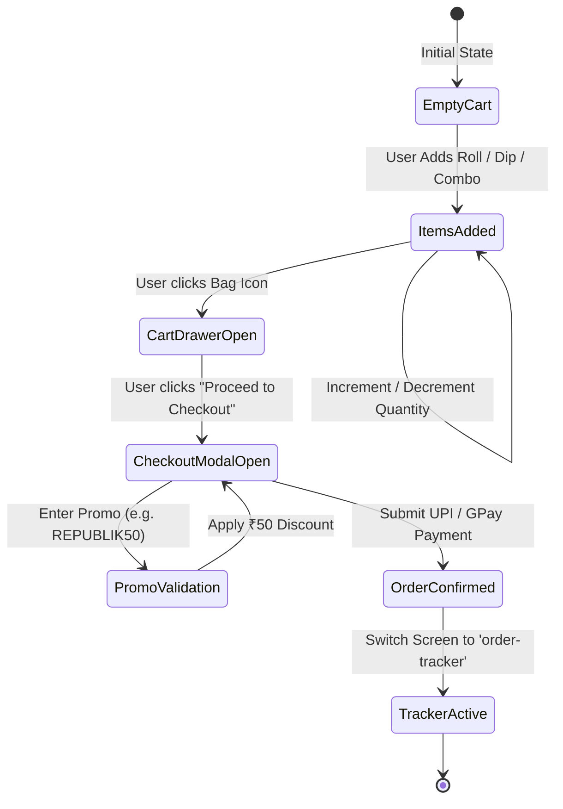
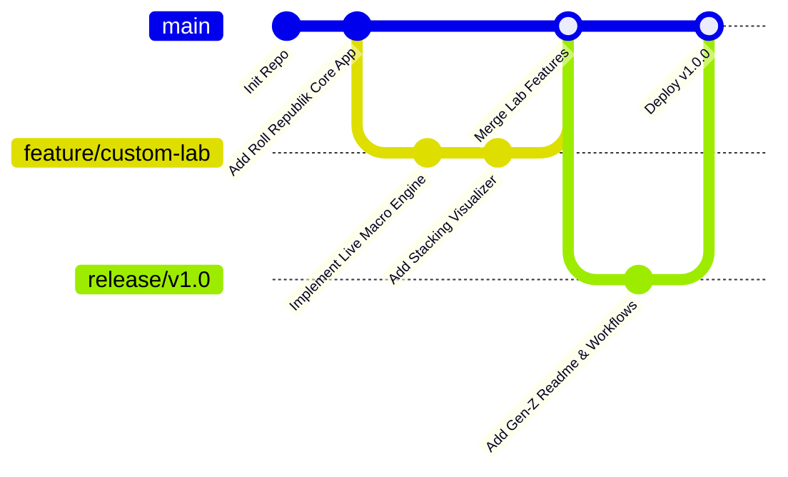

# ⚡ ROLL REPUBLIK — SYSTEM ARCHITECTURE & WORKFLOW SPEC

> **Engineering Architecture, State Lifecycles, and Data Workflows for Roll Republik Web Application.**

---

## 🧭 1. HIGH-LEVEL ARCHITECTURAL WORKFLOW

The diagram below highlights the reactive state propagation across the application from browsing to custom lab crafting, cart manipulation, and kitchen tracking:



---

## 🔄 2. CORE SYSTEM WORKFLOWS

### A. The Custom Roll Lab Workbench Lifecycle
The Roll Lab engine calculates dietary analytics in real-time as the user builds their sandwich:

1. **Wrap Layering**:
   - Computes base calories, fiber, carbs, and base price.
   - Updates the graphical base foundation of the roll visualizer.
2. **Protein Core**:
   - Calculates high-density protein yields (Chicken Tikka, Fried Paneer, Soya Chaap, Double Egg Masala, Mutton Seekh).
   - Adjusts the spice index.
3. **Crunchy Greens (Multi-Select)**:
   - Dynamic inclusion of Sirka Pyaz, Jalapeños, Iceberg shreds, Charred Corn, and Bell Peppers (+15 kcal per unit).
4. **House Sauce Blend (Dual Select)**:
   - Restricts formulation to max 2 concurrent signature sauces to preserve structural integrity and flavor balance (+35 kcal per unit).
5. **Aromatic Dusting**:
   - Crowns the build with Gunpowder Podi, Chaat Crunch, or Oregano Garlic Dust.
6. **Naming & Basket Injection**:
   - The user assigns a custom tag (`rollName`), serializes nutritional metadata into the item's `customDetails`, and pushes it to `cartItems`.



---

## 🛒 3. CART & CHECKOUT WORKFLOW



---

## 🛰️ 4. ORDER FULFILLMENT & TELEMETRY WORKFLOW

1. **Order Acceptance (`Stage 1`)**:
   - Dispatches simulated ticket to Hub Station screen.
   - Generates persistent Order ID `#RR-8921`.
2. **Iron Tawa Firing (`Stage 2`)**:
   - Tandoor & Wok temperature sensors monitor 380°C - 420°C heat ranges.
   - Marinated fillings hit iron griddles.
3. **Laccha Paratha Glazing & Rolling (`Stage 3`)**:
   - Live status badge flashes `"On Iron Tawa 🔥"`.
   - Direct kitchen ping dialog allows instant dietary notes to head chef.
4. **Campus Dispatch (`Stage 4`)**:
   - Assigns campus fleet rider (e.g. *Manpreet Singh, Hero Splendor*).
   - Generates arrival estimations with instant telemetry call routing.

---

## 📦 5. PROJECT DIRECTORY & MODULE CONTRACTS

```
Roll wala/
├── index.html          # Complete Single-File Standalone Client (Zero dependencies needed)
├── run-app.bat         # Windows Instant Double-Click Launcher
├── server.ps1          # Lightweight Native Localhost HTTP Server (port 3000)
├── package.json        # Vite + React + TypeScript Dependency Specs
├── tsconfig.json       # TypeScript Strict Compiler Settings
├── vite.config.ts      # Vite Bundler Plugins & Configuration
├── README.md           # Gen-Z Aesthetic Documentation & User Guide
├── workflow.md         # Full System Architecture & Data Flow Guide
└── src/
    ├── main.tsx        # React 18 DOM Root Mounting Point
    ├── index.css       # Tailwind & Neo-Brutalist Shadow Classes
    └── App.tsx         # Fully Typed Single-File Application Controller
```

---

## 🚀 6. CI/CD & REPOSITORY DEPLOYMENT WORKFLOW



1. **Local Development**:
   - Launch with `run-app.bat` or run `powershell -File .\server.ps1` to test on `http://localhost:3000/`.
2. **Git Commit & Remote Push**:
   - Staged changes are packaged with descriptive commit conventions.
   - Pushed directly to `https://github.com/Monali-234/Rollwala.git` on the `main` branch.
3. **Zero Build Bottlenecks**:
   - The standalone `index.html` requires zero build steps, making it instantly previewable via GitHub Pages or any static host (Netlify, Vercel, Cloudflare Pages).
